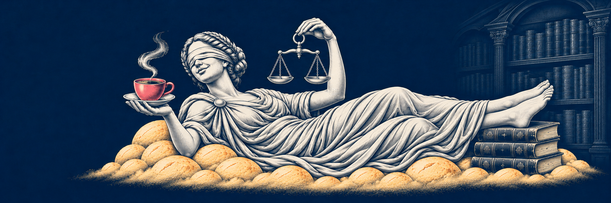

# Guia de artes e referências

Este guia operacionaliza o padrão de ilustração do Gabriel Ramos Visual System. Reúne direção, referência-mestra e critérios de revisão; não implementa um gerador nem um sistema complexo de componentes.

Leia junto do [sistema visual](visual-system.md). **Contemporary Editorial Engraving** permanece o nome autoral descritivo da direção visual do Gabriel Ramos Visual System, não uma escola histórica nem uma técnica única.

## Referência-mestra e ordem de consulta

A [imagem original da Dama](references/dama-reference.png), fornecida pelo usuário como `new.png`, é a referência visual aprovada. Foi efetivamente inspecionada em 6 de novembro de 2026 e copiada sem alterações. [Proveniência e SHA-256](references/README.md).

Ela cumpre dois papéis: **referência-mestra da linguagem ilustrativa comum** e **referência de identidade da Dama**. Compartilhar a linguagem não obriga os demais personagens a ter rosto, anatomia, roupa, objetos ou cenário da Dama.

1. **Sistema e interface:** [visual-system.md](visual-system.md) e os tokens CSS definem cores, tipografia e superfícies do site.
2. **Ilustração comum:** a imagem-mestra e a [seção canônica do sistema](visual-system.md#referência-mestra-de-ilustração-e-personagens) definem acabamento, hierarquia e relação entre solenidade e humor.
3. **Identidade:** a ficha de cada personagem define seus atributos próprios e as variantes aprovadas; para a Dama, consultar [characters/dama.md](characters/dama.md).
4. **Cena:** o briefing de cada peça define pose, ambiente, objetos, proporção e espaço para texto, respeitando as camadas anteriores.

Se uma nova proposta contrariar uma dessas referências, registrar o conflito e pedir uma decisão antes de tratá-la como padrão. Uma imagem de teste não substitui a referência-mestra automaticamente.

Essa aprovação se refere à referência visual. Os [prompts de especificação](image-prompts.md) deste repositório são propostas para revisão; não são prompts ou novas imagens aprovadas. A imagem documental não é carregada pelo site e não deve ser movida para `public/` ou importada em páginas por conveniência.

## Aplicação da direção

As regras compartilhadas ficam na [referência-mestra do sistema visual](visual-system.md#referência-mestra-de-ilustração-e-personagens), sem um segundo conjunto de normas neste guia. O contraste entre a solenidade da Justiça e o café com pães de queijo é a cena específica da Dama, detalhada em sua [ficha](characters/dama.md). A linguagem monocromática do Droppy não substitui essa ficha.

## Tokens compartilhados

Os valores permanecem nos [tokens CSS existentes](../../src/styles/global.css); este guia reutiliza seus nomes e papéis, sem criar um segundo arquivo de tokens.

| Token existente | Aplicação às artes |
| --- | --- |
| `--ivory` | Figura, luz e áreas claras; não presumir que cada pixel da referência tenha o valor exato do token |
| `--navy` | Fundo profundo, sombras e linhas de gravura |
| `--pink` | Acento pontual, como a xícara; em CTA do site, texto marinho |
| `--gold` | Apoio dentro da ilustração, como os pães de queijo |
| `--ink`, `--muted`, `--border` | Texto e elementos editoriais limpos, quando presentes fora da imagem |
| `--display` | Fraunces: marca 600; títulos 500/600 |
| `--body` | Source Sans 3: corpo 400; interface 400–600 |

Use as fontes locais já presentes. Para peças com texto, prefira compor a tipografia numa camada editorial separada; a ilustração não deve inventar inscrições, legendas ou marcas. Texto, campos e botões ficam livres de textura. O PNG aprovado contém gradações e acentos próprios; os tokens orientam novas especificações, sem recolorir o original.

## Como preparar uma arte

1. Ler este guia e abrir visualmente o [PNG original](references/dama-reference.png), não apenas ler sua descrição. Consultar também a ficha e a referência próprias do personagem; para a Dama, usar [esta ficha](characters/dama.md). Se elas ainda não existirem, registrar a pendência antes de definir sua identidade.
2. Definir objetivo, uso, proporção, cena, mudança pedida e elementos que devem permanecer. A pose reclinada é a pose da referência, não obrigação para todas as cenas.
3. Usar os [prompts de especificação](image-prompts.md), distinguindo referência aprovada de proposta ainda não revisada. Se uma ferramenta for utilizada no futuro, anexar os pixels da referência de fato: citar o caminho no texto não equivale a fornecer a imagem.
4. Confrontar a proposta com as invariantes e as mudanças autorizadas. Não presumir que um modelo preservará identidade com perfeição.
5. Comparar a linguagem comum com a referência-mestra e a identidade com a ficha correspondente. Para a Dama, revisar rosto visível, venda, cabelos, drapeado, mãos, balança e props. Guardar qualquer saída futura separadamente, sem sobrescrever o original.

## Checklist de aceitação

- [ ] A referência-mestra e a referência do personagem foram abertas e comparadas com a proposta.
- [ ] Hachuras e pontos constroem volume, sem ruído uniforme, aparência plástica/3D ou simplificação em cartoon genérico.
- [ ] Identidade e atributos do personagem foram preservados, sem copiar atributos de outro personagem.
- [ ] Anatomia, mãos, pés, objetos e perspectiva estão coerentes; não há deformações ou repetições involuntárias.
- [ ] Paleta e eventuais variantes documentadas foram respeitadas; rosa e dourado não viraram preenchimento generalizado.
- [ ] Composição e recorte preservam leitura; o fundo escuro da arte não redefine o tema claro do site.
- [ ] Texto, campos e botões permanecem sem textura; tipografia editorial usa as fontes locais do sistema.
- [ ] Originais não foram sobrescritos; proposta, teste e aprovação do usuário têm estados distintos.

Esta consolidação documental não executa novas gerações. O andamento dos testes já iniciados fica em [prompt-tests.md](prompt-tests.md). [Fontes e limites das capacidades anunciadas pela OpenAI](sources-images.md) orientam a pesquisa, sem configurar modelo, endpoint ou parâmetros de API.
