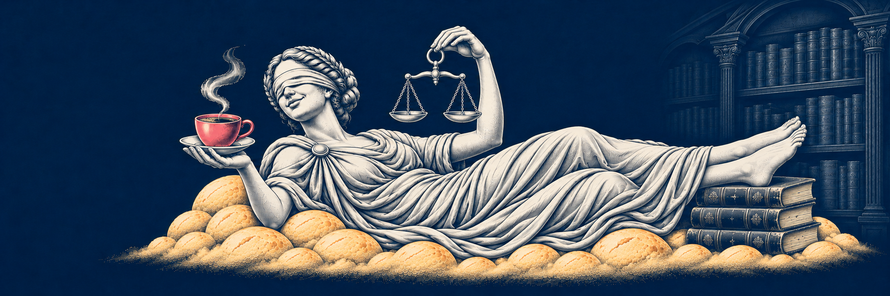

# Referência visual da Dama

- Arquivo: [dama-reference.png](dama-reference.png).
- Origem: imagem anexada pelo usuário, recebida com o nome `new.png` e disponível localmente em Downloads no momento da cópia.
- Registro e inspeção visual: 6 de novembro de 2026.
- Papel: referência visual aprovada para a Dama; não é uma nova geração nem uma referência do Droppy.
- Preservação: cópia byte a byte, sem redimensionar, recortar, recomprimir, recolorir ou editar metadados.
- Dimensões: 2172 × 724 pixels; tamanho: 2.731.354 bytes; formato PNG.
- SHA-256: `e0502c5a4359058a2b29561559751d1a609919d2c8de15b7534b971a1ce2e0e9`.
- Manifesto verificável: [dama-reference.json](dama-reference.json); o campo `asset` resolve relativamente a esta pasta.

A aprovação visual é informada pelo usuário. Não há neste registro comprovação de autoria, licença pública ou exclusividade jurídica. A referência fica na documentação, fora de `public/` e das importações do site. A cópia original fornecida não foi alterada. As descrições e prompts derivados são propostas documentais para revisão.

Consulte a [ficha da Dama](../characters/dama.md) e o [guia de artes](../image-guide.md). Novas saídas devem usar outros arquivos, com sua própria proveniência, sem sobrescrever este original.
